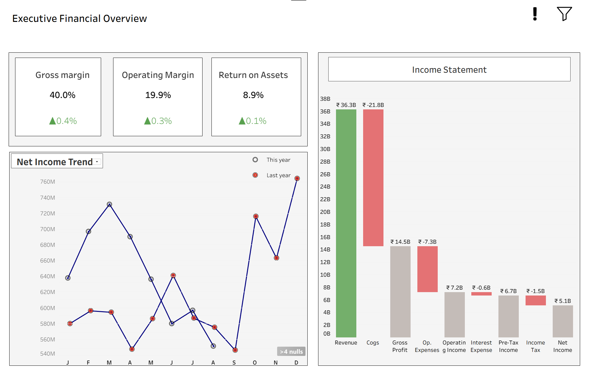
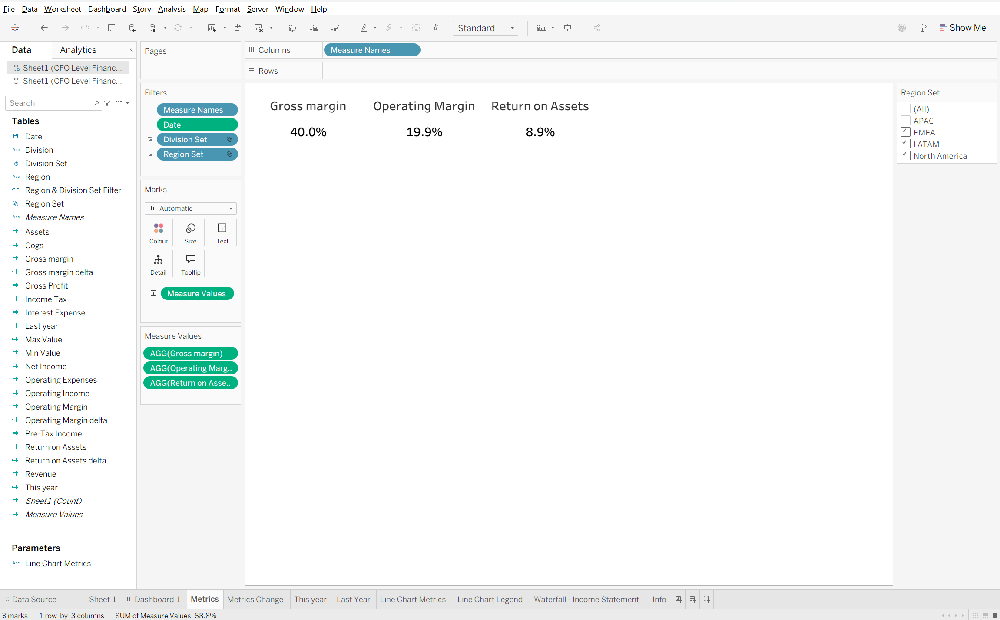
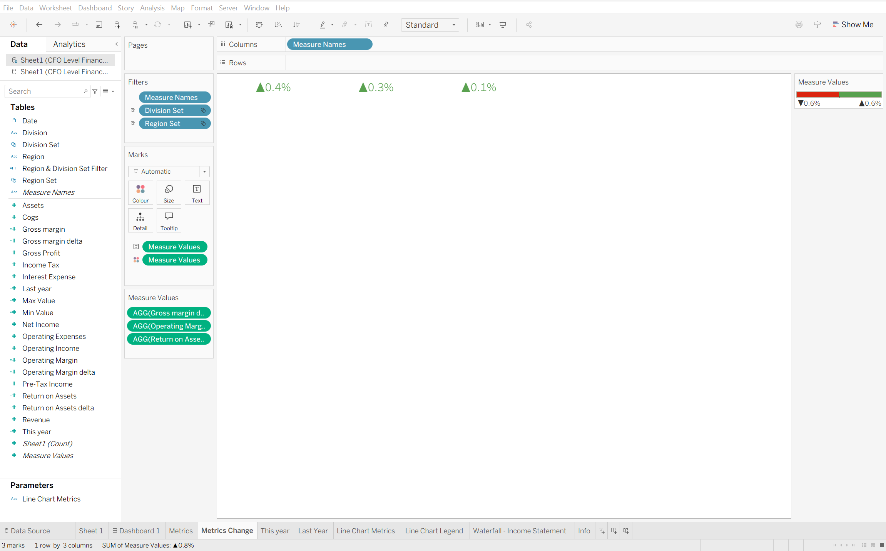
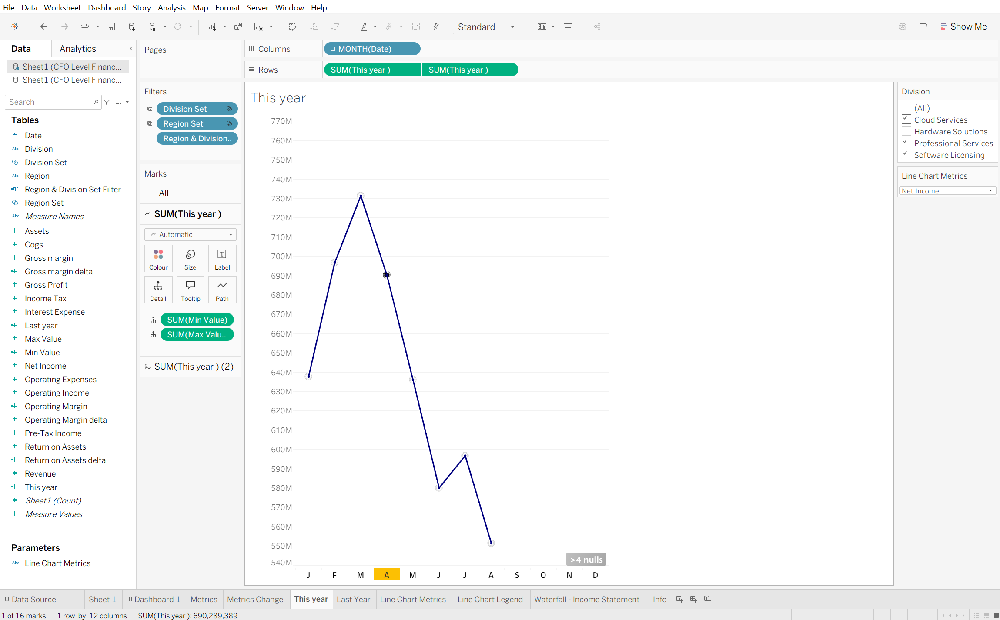
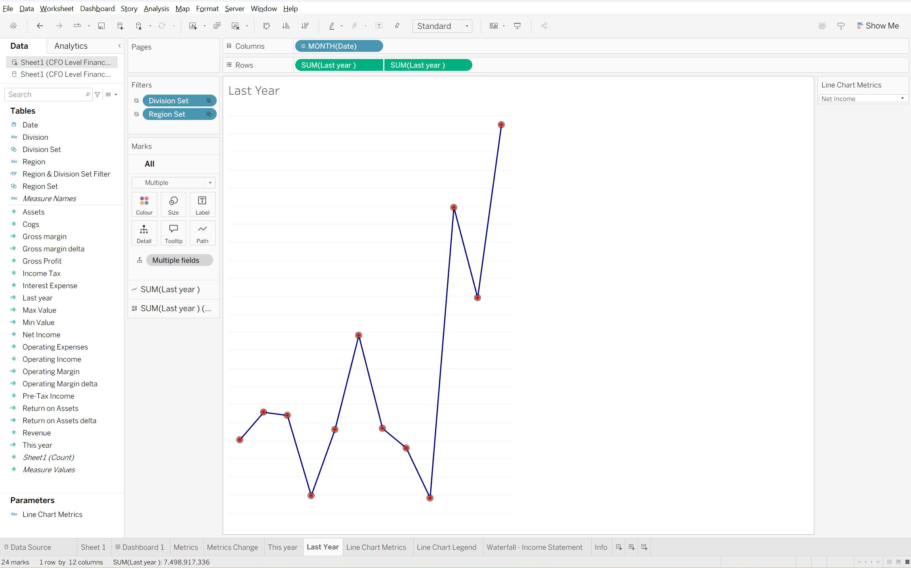
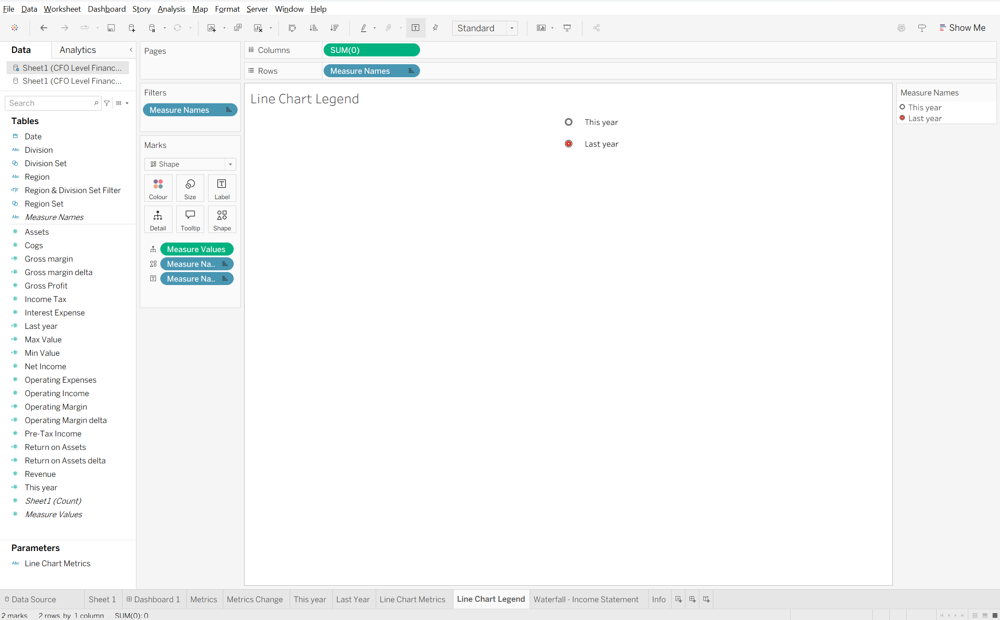
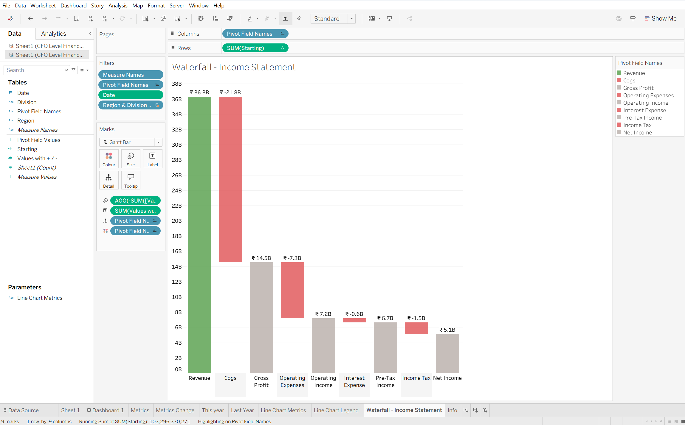
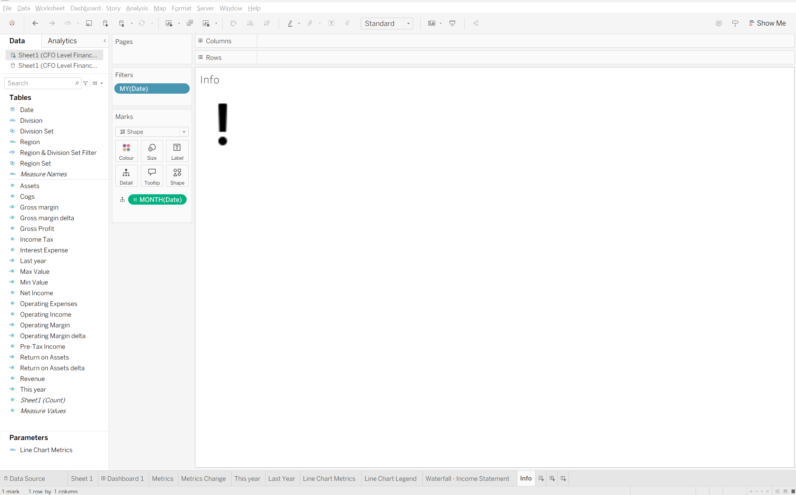

# Executive Financial Overview: CFO-Level Dashboard in Tableau



A single-page Tableau dashboard for executive-level financial reporting: KPI cards with year-over-year change, a this-year-vs-last-year trend line with a metric selector, an income statement waterfall, and Division/Region filters behind a show/hide button.

> **Related:** my general Tableau study notes, where the underlying concepts are written up, are in [tableau-notes](https://github.com/YOUR-USERNAME/YOUR-NOTES-REPO) (notes from the Simon Says IT course). See [Concepts applied](#concepts-applied).

---

## What's on the dashboard

| Component | Worksheet(s) | Main technique |
|---|---|---|
| KPI cards: Gross margin, Operating Margin, Return on Assets | `Metrics` | Calculated fields, Measure Names/Values table |
| Year-over-year change with ▲/▼ and red/green | `Metrics Change` | Delta calculations, custom number format, diverging colour palette |
| This year vs last year trend | `This year`, `Last Year` | Discrete months, conditional year fields, dual axis |
| Metric selector (8 metrics) | `Line Chart Metrics` | String parameter + `CASE` |
| Synced axes across two sheets | `This year`, `Last Year` | Nested `FIXED` LODs + hidden reference lines |
| Custom legend | `Line Chart Legend` | Shape marks + `SUM(0)` |
| Income statement waterfall | `Waterfall - Income Statement` | Pivot, Gantt bar, running total |
| Division / Region filters across data sources | dashboard sets | Sets inside LODs, data blending |
| Show/hide filter button | dashboard | Vertical container + button |
| Info tooltip | `Info` | Shape mark + tooltip |

## Data

- `CFO Level Financial Metrics.xlsx` (from the tutorial resources, **not redistributed here**).
- 320 rows, monthly, **Jan 2024 to Aug 2025** (20 months). 2025 is deliberately incomplete, which is the "current year isn't finished" case the trend line handles.
- 4 divisions (Cloud Services, Hardware Solutions, Professional Services, Software Licensing) x 4 regions (APAC, EMEA, LATAM, North America).
- Fields: Revenue, COGS, Gross Profit, Operating Expenses, Operating Income, Interest Expense, Pre-Tax Income, Income Tax, Net Income, Assets.
- Currency isn't specified in the data. The ₹ on the waterfall is just the number format I chose.

The screenshots show a filtered view (Hardware Solutions and APAC deselected), so figures differ slightly from the unfiltered totals.

---

## How it's built

### 1. Layout
The layout is made entirely from empty text boxes: a light-grey base layer, a white layer inset for a border effect, and a box for each visual. Worksheets are then placed on top with their shading removed so the boxes show through.

### 2. KPI cards



```
Gross margin     = SUM([Gross Profit]) / SUM([Revenue])
Operating Margin = SUM([Operating Income]) / SUM([Revenue])
Return on Assets = SUM([Net Income]) / SUM([Assets])
```

The `SUM` inside each ratio makes Tableau add everything up first and divide afterwards. Using ratios rather than totals shows efficiency and profitability, and shows that KPI cards don't have to come from fields already in the data.

**Year-over-year change** (margin this year minus margin last year):

```
Gross margin delta =
  SUM(IF YEAR([Date]) = YEAR(TODAY()) - 1 THEN [Gross Profit] END)
  / SUM(IF YEAR([Date]) = YEAR(TODAY()) - 1 THEN [Revenue] END)
-
  SUM(IF YEAR([Date]) = YEAR(TODAY()) - 2 THEN [Gross Profit] END)
  / SUM(IF YEAR([Date]) = YEAR(TODAY()) - 2 THEN [Revenue] END)
```

Operating Margin delta and Return on Assets delta follow the same pattern.



The ▲/▼ arrows come from a three-part custom number format (`positive;negative;zero`):

```
▲ 0.0%;▼ 0.0%; 0.0%
```

Colour is a two-step custom diverging palette (red for negative, green for positive), centred on zero.

### 3. This year vs last year trend line



Months are plotted as **discrete** months (not continuous), so both years share one axis even though they're different years. Each year gets its own field, which returns values only for that year:

```
This year =
IF YEAR([Date]) = YEAR(TODAY()) - 1 THEN
  CASE [Line Chart Metrics]
    WHEN "Revenue"            THEN [Revenue]
    WHEN "COGS"               THEN [COGS]
    WHEN "Gross Profit"       THEN [Gross Profit]
    WHEN "Operating Expenses" THEN [Operating Expenses]
    WHEN "Operating Income"   THEN [Operating Income]
    WHEN "Interest Expense"   THEN [Interest Expense]
    WHEN "Pre-Tax Income"     THEN [Pre-Tax Income]
    WHEN "Income Tax"         THEN [Income Tax]
    WHEN "Net Income"         THEN [Net Income]
  END
END
```

`Last year` is identical with `- 2`. **`Line Chart Metrics`** is a string parameter with a list of allowable values, so one chart can show any of the measures. Because 2025 stops in August, the last four months show as nulls, which I left in on purpose instead of filtering out.

### 4. Syncing axes across worksheets

Tableau allows one dual axis per sheet. To get a fully custom marker on top of a line, I used **two sheets** (`This year` and `Last Year`) layered on the dashboard. Each sheet scales its own axis, so they don't line up until the axes are anchored to the same minimum and maximum.



`Min Value` and `Max Value` are `FIXED` LODs that find the lowest and highest monthly total across both years. Each is added to the sheet and used as a **reference line**, which stretches the axis to include it. The reference lines are then hidden, so they cap the axis without being visible. Because they're `FIXED`, the result is the same on both sheets whatever each view contains.

```
Min Value =
IF
  { FIXED : MIN( { FIXED YEAR([Date]), MONTH([Date]) :
      SUM(IF [Division] IN [Division Set] AND [Region] IN [Region Set]
          THEN [Last year] END) } ) }
<
  { FIXED : MIN( { FIXED YEAR([Date]), MONTH([Date]) :
      SUM(IF [Division] IN [Division Set] AND [Region] IN [Region Set]
          THEN [This year] END) } ) }
THEN { FIXED : MIN( ... Last year ... ) }
ELSE { FIXED : MIN( ... This year ... ) }
END
```

(`Max Value` swaps `MIN` for `MAX` and `<` for `>`; the full version is in the workbook.) The `Division Set` / `Region Set` logic inside the LOD is explained in [section 7](#7-filtering-across-data-sources).

### 5. Custom legend



A default colour legend wouldn't match the chart's markers, so I built one from a sheet. `SUM(0)` on Columns gives every mark the same horizontal position, Measure Names on Rows gives one row per series, Shape is set by Measure Names, and the text is the label. Custom shape images replace the defaults.

### 6. Income statement waterfall



1. A **second connection** to the same file, with the ten measures **pivoted** into `Pivot Field Names` / `Pivot Field Values`. I kept it separate so the pivot couldn't affect the other visuals.
2. **`Values with + / -`** makes costs negative:
   ```
   IF [Pivot Field Names] = "Cogs"
   OR [Pivot Field Names] = "Income Tax"
   OR [Pivot Field Names] = "Interest Expense"
   OR [Pivot Field Names] = "Operating Expenses"
   THEN -[Pivot Field Values]
   ELSE [Pivot Field Values]
   END
   ```
3. **`Starting`** makes subtotals start at zero, while flows start where the previous step ended:
   ```
   IF [Pivot Field Names] = "Gross Profit"
   OR [Pivot Field Names] = "Net Income"
   OR [Pivot Field Names] = "Operating Income"
   OR [Pivot Field Names] = "Pre-Tax Income"
   THEN 0
   ELSE [Values with + / -]
   END
   ```
4. `Pivot Field Names` on Columns (sorted manually in income-statement order), `Starting` on Rows with a **running total** table calculation, mark type **Gantt Bar**, and `-SUM([Values with + / -])` on Size to make the bars the right length and direction.
5. Colour: green for revenue, red for costs and expenses, grey for subtotals.

### 7. Filtering across data sources

The metrics sheets use `FIXED` LODs, which ignore ordinary dimension filters, and joining the two sources would break that. Instead:

- `Division` and `Region` are turned into **sets** and shown as filters.
- The set logic is written **inside** the LODs (`IF [Division] IN [Division Set] AND [Region] IN [Region Set] THEN ... END`), so records are filtered *before* the LOD runs.
- The pivoted source can't use the sets directly (they show greyed out), so a boolean `Region & Division Set Filter` does the filtering there, and `Division` and `Region` are linked in the blend.

```
Region & Division Set Filter = [Region] IN [Region Set] AND [Division] IN [Division Set]
```

The filters live in a vertical container with a **show/hide button**, so they don't clutter the dashboard.

### 8. Info tooltip



A one-mark sheet with a custom icon as the shape. The text and the most recent month come from the tooltip, so the dashboard can carry extra context without a permanent text box.

<!-- TODO: add screenshots/filters-open.png (filter panel open) and screenshots/info-tooltip-hover.png (tooltip on hover) -->

---

## Concepts applied

Each of these is written up in my [Tableau study notes](https://github.com/DeepthiThakkum/tableau-notes):

| What I used here | Notes section |
|---|---|
| Measure Names / Measure Values, discrete vs continuous, marks | [Building a View](https://github.com/DeepthiThakkum/tableau-notes#9-building-a-view) |
| Second pivoted data source, blending and link icons | [Combining Data](https://github.com/DeepthiThakkum/tableau-notes#10-combining-data) |
| Metric-selector parameter | [Parameters](https://github.com/DeepthiThakkum/tableau-notes#11-parameters) |
| Nested `FIXED` LODs for axis min/max | [Level of Detail (LOD) Expressions](https://github.com/DeepthiThakkum/tableau-notes#12-level-of-detail-lod-expressions) |
| Division / Region sets | [Groups and Sets](https://github.com/DeepthiThakkum/tableau-notes#13-groups-and-sets) |
| Why `FIXED` ignores dimension filters | [Filters and Order of Operations](https://github.com/DeepthiThakkum/tableau-notes#16-filters-and-order-of-operations) |
| Running total behind the waterfall | [Table Calculations](https://github.com/DeepthiThakkum/tableau-notes#17-table-calculations) |

---

## Challenges and fixes

Most of the learning came from things that didn't work the first time.

| Problem | Cause | Fix |
|---|---|---|
| KPI table showed **"No data available"** | The Date filter was a *relative* "This year" filter. The data is 2024-25 and "this year" resolved to 2026 | Switched to **Previous year** after checking the data's actual date range |
| Waterfall table showed one huge strip of numbers per row | The pivot had pulled in **Date, Division and Region** as well as the measures | Kept only the ten numeric measures in the pivot |
| Waterfall showed `320` for every row | The pill was `CNTD` (count distinct) rather than `SUM` | Changed the aggregation to Sum |
| **Pre-Tax Income bar floated instead of starting at zero** | `Starting` tested for `"Pre-tax Income"`, but the data says `"Pre-Tax Income"` and Tableau text comparison is **case-sensitive** | Corrected the spelling in the formula |
| Calculated-field errors | Missing `END`, unbalanced parentheses, `YEAR(DATE)` without brackets, `AND` typed instead of `IN` | Read the editor's validity message, then rewrote the formula in smaller parts |
| LOD min/max didn't react to the filters | `FIXED` LODs ignore ordinary dimension filters | Moved the set logic *inside* the LOD |
| Sets greyed out on the pivoted source | Sets belong to the other data source | Used a boolean set-filter field and linked `Division` / `Region` in the blend |

## Limitations

- **Year logic depends on today's date.** "This year" is `YEAR(TODAY()) - 1` and "last year" is `YEAR(TODAY()) - 2`, which matches this dataset (2024-2025) today but will go blank once the calendar moves on. For a permanent dashboard I'd drive the years from the latest date in the data instead of `TODAY()`.
- The data is from the tutorial and is synthetic, so the numbers aren't real company results.
- Built in Tableau Desktop; I haven't published it to Tableau Public.

## Files

```
tableau-finance-dashboard/
├── README.md
├── screenshots/            # dashboard and per-sheet screenshots
└── (optional) Finance Overview.twb
```

## Credits

- Tutorial, dataset, formulas and icon images: [Golden Insights](https://www.youtube.com/watch?v=W9MylRvylUk).
- Concepts: [Simon Says IT](https://github.com/YOUR-USERNAME/YOUR-NOTES-REPO) course notes.
